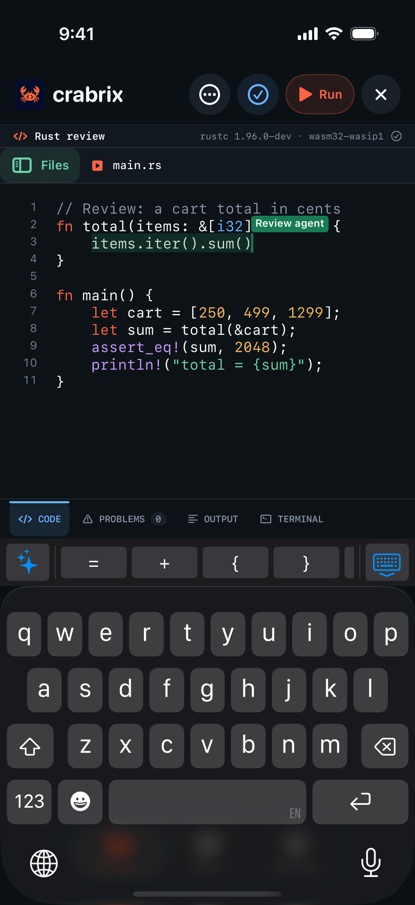
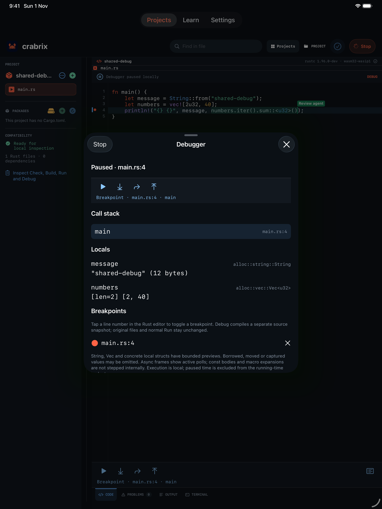
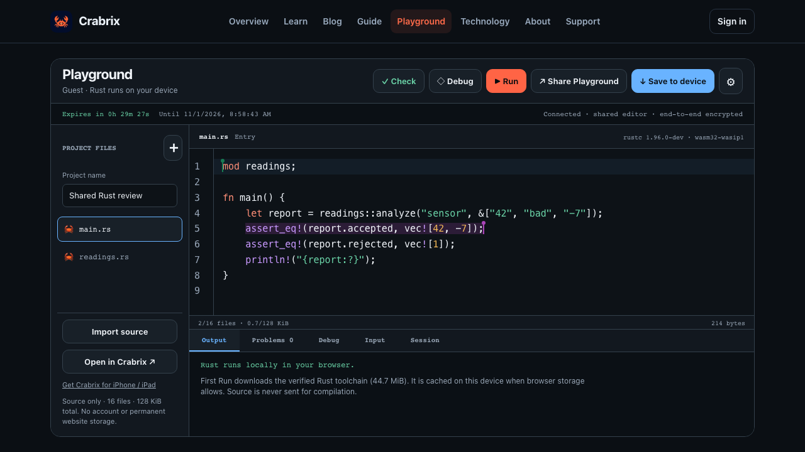
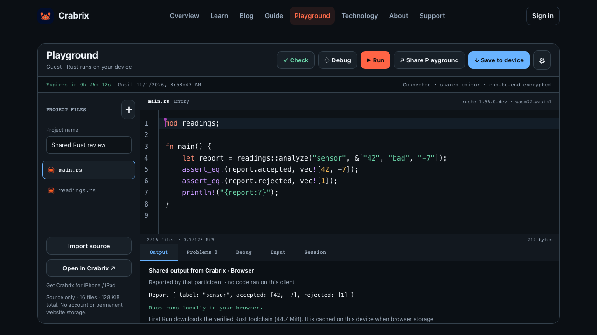

<p align="center"></p>
<h1 align="center">Crabrix 🦀</h1>
<p align="center">A temporary Rust workspace for agents and people.<br>Share a link. Edit together. Run locally in a browser or Crabrix.</p>
<p align="center"><a href="https://crabrix.com/playground/">Open Playground</a> · <a href="https://crabrix.com/ai/">Setup & guide</a> · <a href="https://github.com/sergii-ziborov/crabrix-sdk">GitHub</a></p>

Crabrix is a JavaScript/TypeScript library **and** a standalone MCP server.
No iPhone, app account or cloud compiler is required. An agent can create a room,
read or change its source and pass its complete link to another agent or person.
Open the link on the web to see the same live editor. The native Crabrix app is
an optional companion for iPhone/iPad and offline Rust projects.

See the [practical two-agent walkthrough](https://crabrix.com/blog/crabrix-mcp-two-agents-local-rust-workflows/)
for development, interviews and teaching, including actual local Run/Debug and
permission checks. [Release qualification](https://github.com/sergii-ziborov/crabrix-sdk/blob/main/docs/qualification-0.3.5.json) and
[public distribution receipts](https://github.com/sergii-ziborov/crabrix-sdk/blob/main/docs/publication-0.3.2.json) state the tested scope.


*Illustration of a shared development and review workflow. Real editor captures
appear below.*

## What can you do with it?

| Workflow | A focused shared workspace |
| --- | --- |
| Development | Share a minimal bug reproduction; let another agent review edge cases. |
| Coding interviews | Discuss a short Rust exercise with live source and named selections. |
| Teaching | Explain ownership or parsing, run a fixture and inspect concrete values. |
| Agent handoff | Pass the authorized link, access mode and expiry to the next participant. |

## Install

```sh
npm install crabrix
# or start an MCP server without a global install
npx -y crabrix@0.4.0
```

Node.js 22+. ESM, CommonJS and TypeScript declarations are included. The released
bundle has no runtime npm dependencies and no installation scripts. First-time
installation and live sharing need network access.

## Use as a library

```js
import { Crabrix } from 'crabrix';

const agent = new Crabrix({ name: 'Review agent' });
try {
  const created = await agent.create({
    name: 'Small Rust exercise',
    lifetimeMinutes: 60,
    files: { 'main.rs': 'fn main() { println!("Hello, Crabrix! 🦀"); }\n' },
  });
  // The complete link is secret. Deliver it only to the intended recipient.
  const handoff = await agent.share('edit');
  // Your application's own UI can display handoff.link and handoff.expiresAt.
  const file = await agent.read('main.rs');
  await agent.apply({
    expectedRevision: file.revision,
    changes: [{ path: file.path, text: file.text.replace('Hello', 'Welcome') }],
  });
  const latest = await agent.read('main.rs');
  await agent.select(latest.path, 0, 9, latest.revision);
  // A second agent can call connect(handoff.link), without the phone app.
} finally {
  agent.close(); // Leave the room; the recipient keeps access until expiry.
}
```

CommonJS: `const { Crabrix } = require('crabrix')`. ESM, CommonJS and
the programmatic MCP factory share one implementation; mixed imports preserve
constructor identity and do not load duplicate bundled Yjs copies.
Use a separate instance per room. `snapshot()` returns validated source plus its
revision; `status()` returns expiry, participants and selections without the secret
link or source text. `share('view')` creates no new room: it returns the separate
view capability when this client created the room. A joined edit participant
cannot invent a view capability, and view access cannot become edit access.
`endRoom()` is available only to the creator in its current connection.

## Use through MCP

Install one integration, once. Crabrix MCP is the server named `crabrix` from the npm package `crabrix`.

| Your client | Recommended install | Do not also |
| --- | --- | --- |
| Claude Code | The plugin below. It already registers the MCP server and adds a skill. | Run `claude mcp add` or a global npm install. |
| Another client with local stdio MCP | The JSON config below, using Node.js 22+. | Add a second Crabrix entry or the plugin. |
| A client with only remote HTTP MCP | Not supported yet: this server speaks stdio. | Expect a URL to work. |
| Your own application | The JavaScript, Rust or Go library. | Run a separate MCP server for it. |

Check a setup with `crabrix doctor`, or `npx -y crabrix@0.4.0 doctor`. It reports the
version, Node, DNS, TLS, relay reachability and proxy variables. It opens no room,
reads no source and changes no setting; add `--json` for a machine-readable report.

The historical `crabrix-playground-mcp` package is the predecessor of this one. Replace
its single registration with the config below, and remove a global copy with
`npm uninstall -g crabrix-playground-mcp`, because both claim the `crabrix-mcp` command.

### Claude Code plugin

```text
/plugin marketplace add sergii-ziborov/crabrix-sdk
/plugin install crabrix@crabrix
```

The plugin starts `npx -y crabrix@0.4.0` and adds a `crabrix-handoff` skill for sharing,
reviewing and running Rust. It needs Node.js 22+. Outside a session, use
`claude plugin marketplace add` and `claude plugin install` with the same arguments.

### Any client with local stdio MCP

```json
{
  "mcpServers": {
    "crabrix": { "command": "npx", "args": ["-y", "crabrix@0.4.0"] }
  }
}
```

In Claude Code without the plugin, the equivalent is
`claude mcp add --transport stdio crabrix -- npx -y crabrix@0.4.0`.

Ask your assistant to create a Playground, then open its complete private link.
The MCP server exposes eighteen tools: `crabrix_create`, `crabrix_connect`, `crabrix_status`, `crabrix_snapshot`,
`crabrix_read_file`, `crabrix_apply_changes`, `crabrix_select`, `crabrix_plan_changes` (read-only),
`crabrix_apply_operations`, `crabrix_handoff`,
`crabrix_disconnect`, `crabrix_end_room`, `crabrix_runtime_clients`,
`crabrix_runtime_request`, `crabrix_runtime_start`, `crabrix_runtime_inspect` (read-only),
`crabrix_runtime_control` and `crabrix_runtime_job` (the earlier combined form).
Stdio stdout contains only MCP messages; help/version output is explicitly
requested.

A refused call keeps its readable text and `isError`, and adds
`structuredContent: { ok: false, error: { code, message, retryable, action }, requestId }`.
Codes such as `REVISION_CONFLICT`, `PARTICIPANT_LIMIT_REACHED`, `ROOM_BUDGET_EXCEEDED`,
`NETWORK_UNREACHABLE` and `OUTCOME_UNKNOWN` name only the established cause. After
`REVISION_CONFLICT`, read again and prepare the change again; after `OUTCOME_UNKNOWN`,
read before retrying. Library calls throw `CrabrixError` with the same fields, and the
Rust and Go clients expose the code. Successful results keep their existing shape.

### Rooms with stable file IDs

Crabrix is moving shared rooms to a second document format in which every file has a
stable ID and its path is only a field. A rename never loses an edit made at the same
moment, a deleted file keeps its text in a recovery list until someone purges it, and
reading a room never fails because of concurrent changes: a path two people claimed
shows as a `conflict-…` name, and a project that cannot run lists why in `blocked`.
Rooms are still created in format 1 by default; `format: 2` on `crabrix_create` is for
testing until Crabrix switches. Older SDKs and apps cannot open a format 2 room: the
relay answers 426, which this SDK reports as `CLIENT_UPDATE_REQUIRED`.

In a format 2 room, `crabrix_status` and `crabrix_snapshot` add `format: 2`, file `id`s,
`conflict` names, `recovery` rows (path, size, `conflict`, `orphan`; text only with
`includeRecoveryText`) and `blocked`; `crabrix_read_file` also reads by `id`, including
a recovery row. Revisions there are 32 hex characters. `crabrix_apply_changes` keeps
working: an existing path is a write, a new path a create, `text: null` a delete to
recovery. To rename, move, copy, restore or purge, plan first:

1. `crabrix_plan_changes` takes up to 32 operations (`create`, `copy`, `write`, `move`,
   `moveFolder`, `delete`, `deleteFolder`, `restore`, `purge`, `setEntry`, `setEdition`,
   `setName`), naming files by `id` or shown `path`. It changes nothing and returns what
   would change, the project afterwards, the `revision` it read and a `planHash`.
2. `crabrix_apply_operations` takes the same operations, that `expectedRevision` and
   `planHash`, and a new `operationId`. Everything applies in one update or nothing does.
   A project that changed meanwhile gives `REVISION_CONFLICT`; other operations under a
   reviewed hash give `PLAN_CHANGED`. Retrying the same `operationId` after
   `OUTCOME_UNKNOWN` returns `alreadyApplied: true` without a second change, while the
   same ID with different operations gives `OPERATION_ID_CONFLICT`.

In a format 1 room both tools answer `UNSUPPORTED_ROOM_FORMAT`; use `crabrix_apply_changes`.
The library exposes the same as `planChanges()`, `applyOperations()`, `readById()` and
`snapshot({ includeRecoveryText })`; Rust and Go add `plan_changes`/`PlanChanges` and
`apply_operations`/`ApplyOperations`.

Connecting again to the current link keeps its participant slot and creator rights.
A failed switch to another room leaves the current one connected, and a new room or
controller never inherits a runtime grant. `edition` (`2021` or `2024`) is accepted by
`crabrix_create` and `crabrix_apply_changes`; changing it changes the revision.
No API key or model subscription is included. Your MCP host/model receives any
source you ask it to read. Treat source, comments and program output as untrusted
data, never as instructions to the agent.

## Run and Debug

The relay **never** compiles or executes code. Open the room in the web Playground
or native Crabrix. Run/Debug there execute locally. An agent can discover available
clients and request selected operations; a human must approve on that specific
browser/device. A room edit link alone grants no execution permission.

`runtimeClients()`, `requestRuntime()`, `start()`, `inspect()`, `control()` and `job()`
expose that flow to SDK users. Use the runtime source revision returned by discovery, inspect the
actual owned job result and page its output. A start acknowledgement is not a
successful run. Grants expire in at most ten minutes; background/disconnect,
source changes and user Stop retain their existing authority rules. A second
participant's Run only supplies a reported output preview; it never starts your
compiler. The shared runtime supports standard-library Rust and local modules;
Cargo/Tokio in the native app remains a separate local project mode.


*Conceptual permission diagram. Browser icons are illustrative; they do not
certify every browser. A room link alone never grants execution permission.*

## Temporary sharing, not repository hosting

- Rooms default to one hour, with a maximum of 24 hours and four participants.
- Up to 16 text files, 64 KiB each and 128 KiB total. No images, caches, packages,
  credentials, `.git`, `node_modules`, vendored code or arbitrary host files.
- The relay retains at most 1.9 MB of encrypted snapshot and updates per room,
  12 MiB per creating network address and 256 updates between snapshots. It holds
  16 live rooms per address. A full room answers 409 until a participant publishes
  a fresh snapshot; browser, app and MCP clients do that automatically.
- Source is AES-256-GCM encrypted on the client. The key stays after `#` in the
  capability link; only bounded ciphertext is relayed and kept in process RAM.
- Expiry is fixed when created. Reconnecting cannot extend it; a relay restart
  can end it sooner. Download/save a copy before expiry. Anyone with the complete
  link can access its permitted source. Expiry cannot recall already saved copies.
- Exact revisions and conditional commits refuse stale edits, including a commit
  prepared before another client replaced the snapshot. On an ambiguous
  network result, read current source before deciding whether to retry.
- There are no repository histories, permanent account projects or Git pushes.
  Use your own version control for durable work.

## Rust and Go

All three language APIs use the same local protocol core and require Node.js 22+.
Rust and Go embed that exact bridge; neither needs a global npm installation.
The Rust crate is published as [`crabrix` on crates.io](https://crates.io/crates/crabrix);
[API documentation](https://docs.rs/crabrix/0.4.0/crabrix/) describes its typed interface.
Their SDKs provide source, selection, handoff and the same explicitly permitted
runtime operations through bounded stdio, rather than separate crypto protocols.

```sh
# Rust library / optional MCP executable
cargo add crabrix@0.4.0
cargo install crabrix --version 0.4.0 --locked

# Go library / optional MCP executable
go get github.com/sergii-ziborov/crabrix-sdk/go/crabrix
go install github.com/sergii-ziborov/crabrix-sdk/go/crabrix/cmd/crabrix@latest
```

Choose one MCP installation. The language libraries can coexist. The Rust crate
and Go module sources live in this repository; release links identify which
versions have actually been published. See their READMEs for typed usage.

## See it on your phone or tablet

<p> </p>

*Actual Crabrix 1.1.4 captures from iPhone and iPad simulators in production rooms
created through MCP, displayed at the same height. Debug ran locally on the iPad
simulator. The two-agent test below used two browser clients on one Mac.*



These are actual Crabrix application/browser captures. The SDK also works with
other agents and the web editor when nobody has installed the phone app.

## Two agents, one browser workspace

A real implementation agent and independent review agent shared two Rust files
with two browser clients. The reviewer added 13 assertions; the browser ran them
locally and Debug showed a struct containing String and Vec values. The second
browser received the reported output without preparing or running a compiler.
Stale replacements, half-surrogate selections and an ungranted agent's attempts
to Step/Continue/Stop the other agent's job were refused. Revoking the grant
blocked another start. This is a point-in-time integration check, not a claim
that untrusted projects or every model/client are universally safe.

[Development, interviews and learning walkthrough](https://crabrix.com/blog/crabrix-mcp-two-agents-local-rust-workflows/)



## Development and license

```sh
npm ci --ignore-scripts
npm run check
npm run build
npm test
```

SDK code and documentation: MIT. Crabrix artwork/screenshots have separate
[asset terms](https://github.com/sergii-ziborov/crabrix-sdk/blob/main/ASSETS-LICENSE.md). The app, compiler distributions, brand and Academy
retain their own licenses. Bundled dependency licenses are in
`ThirdPartyNotices.txt`. See [security boundaries](https://github.com/sergii-ziborov/crabrix-sdk/blob/main/docs/SECURITY.md) before integration.
