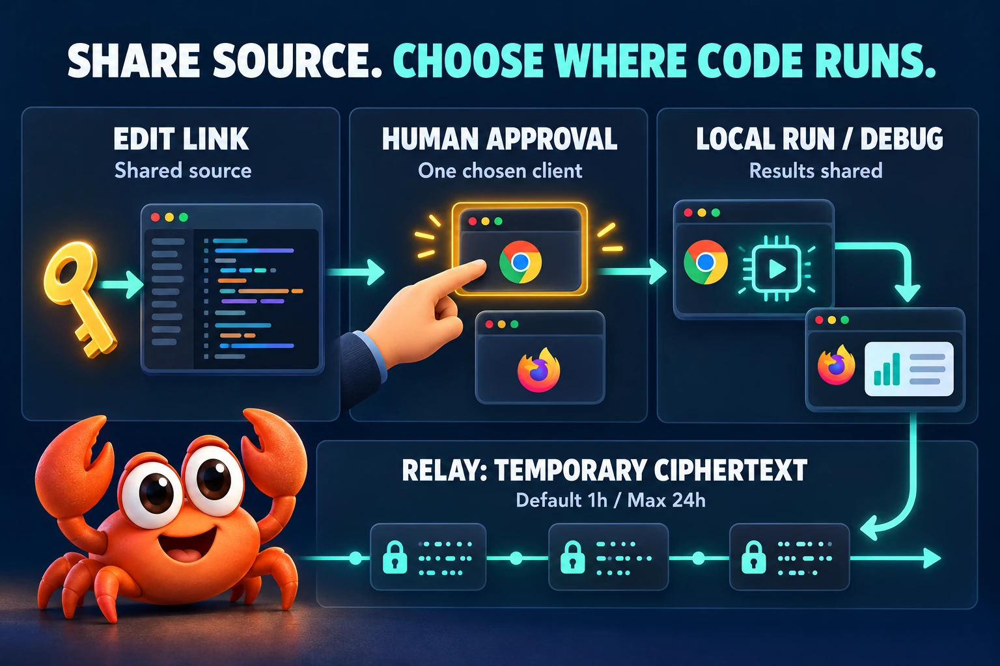
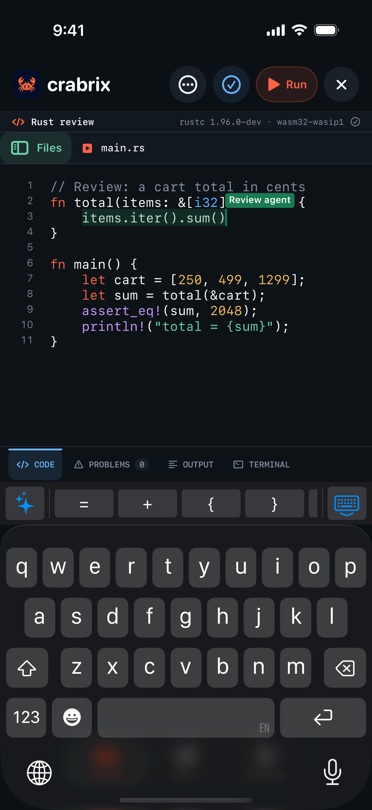
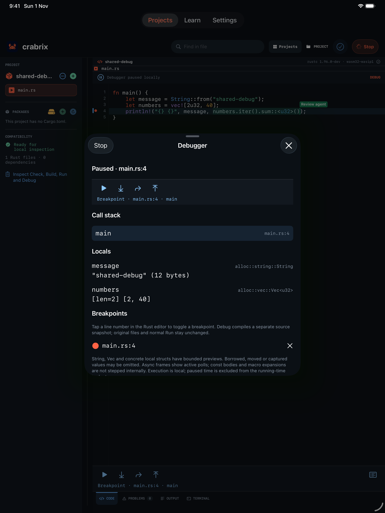
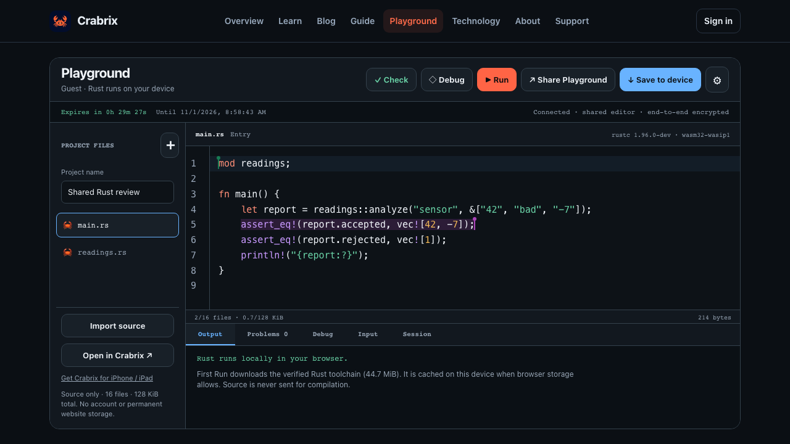

# Crabrix for Go 🦀

Typed Go SDK and MCP launcher for temporary encrypted Rust Playgrounds.
Requires **Node.js 22+**. The same bundled protocol core is embedded; no npm
installation is needed. A browser or another agent can join without a phone app.

```sh
go get github.com/sergii-ziborov/crabrix-sdk/go/crabrix@v0.3.4
go install github.com/sergii-ziborov/crabrix-sdk/go/crabrix/cmd/crabrix@v0.3.4
```

```go
ctx := context.Background()
client, err := crabrix.New(ctx, crabrix.Options{})
if err != nil { return err }
defer client.Close()
room, err := client.Create(ctx, crabrix.CreateOptions{Name: "Go agent exercise"})
if err != nil { return err }
_ = room
handoff, err := client.Share(ctx, "edit") // secret: intended recipient only
if err != nil { return err }
_ = handoff
```

Rooms default to one hour and expire within 24 hours. Four participants, 16 text
files/128 KiB total. The relay retains at most 1.9 MB per room, 12 MiB per creating
network address and 256 updates between snapshots, with 16 live rooms per address;
a full room answers 409 until a participant publishes a fresh snapshot, which
browser, app and MCP clients do automatically. No repository history, account
project or package storage.
Run/Debug need explicit permission on one browser/app; code never runs on the
relay. Go context cancellation closes its owned bridge rather than silently
retrying a possibly committed edit. Exact revisions reject stale proposals.

## Connect Claude Code or another MCP host

The Claude Code plugin needs Node.js 22+ and no Go installation. It starts the npm
launcher and adds a `crabrix-handoff` skill:

```text
/plugin marketplace add sergii-ziborov/crabrix-sdk
/plugin install crabrix@crabrix
```

With the executable from this module:

```sh
claude mcp add --transport stdio crabrix -- crabrix
```

```json
{
  "mcpServers": {
    "crabrix": { "command": "crabrix", "args": [] }
  }
}
```

Choose one plugin, npm, Rust or Go launcher; all expose the same fourteen MCP tools:
`crabrix_create`, `crabrix_connect`, `crabrix_status`, `crabrix_snapshot`,
`crabrix_read_file`, `crabrix_apply_changes`, `crabrix_select`, `crabrix_handoff`,
`crabrix_disconnect`, `crabrix_end_room`, `crabrix_runtime_clients`,
`crabrix_runtime_request`, `crabrix_runtime_start` and `crabrix_runtime_job`.
No model or AI subscription is included. Your MCP host/model receives any source
you ask it to read.

## Development, interviews and teaching

Create a focused example, hand its edit or view link to an intended participant,
and review the same source in a browser. Compare exact revisions before applying
changes; named UTF-16 selections help explain the relevant statement. Local
execution needs a separate grant on the chosen browser/app.

[Practical two-agent walkthrough](https://crabrix.com/blog/crabrix-mcp-two-agents-local-rust-workflows/)



*Conceptual permission diagram. Browser icons are illustrative; they do not
certify every browser. A room link alone never grants execution permission.*

## See it on your phone or tablet

<p> </p>

*Actual Crabrix 1.1.4 captures from iPhone and iPad simulators in production rooms
created through MCP, displayed at the same height. Debug ran locally on the iPad
simulator. The two-agent test below used two browser clients on one Mac.*



These are actual Crabrix application/browser captures. The SDK also works with
other agents and the web editor when nobody has installed the phone app.


SDK code: MIT; separate artwork/screenshot terms in [ASSETS-LICENSE.md](https://github.com/sergii-ziborov/crabrix-sdk/blob/main/ASSETS-LICENSE.md).
[Full docs](https://github.com/sergii-ziborov/crabrix-sdk).
